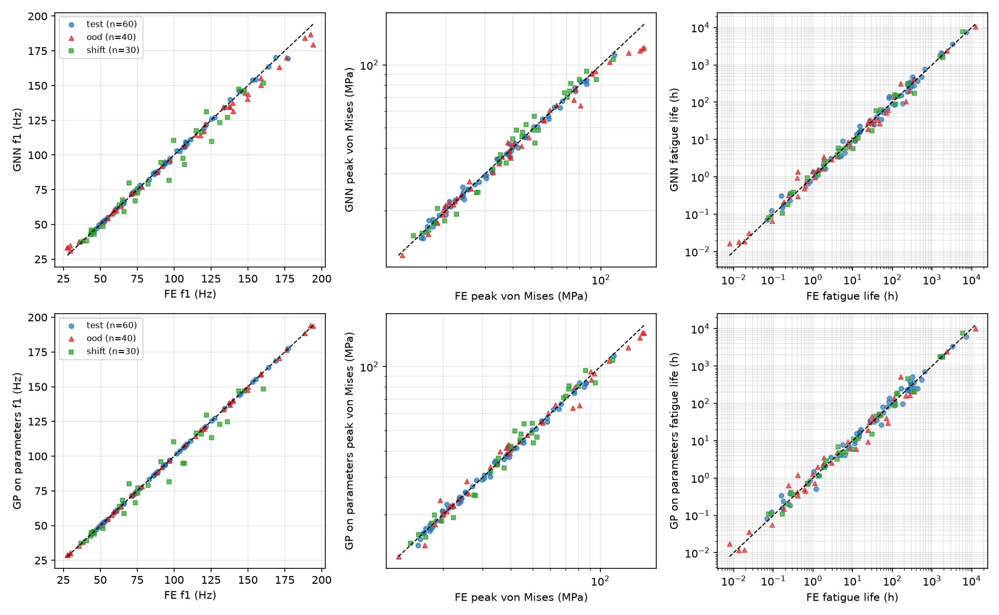
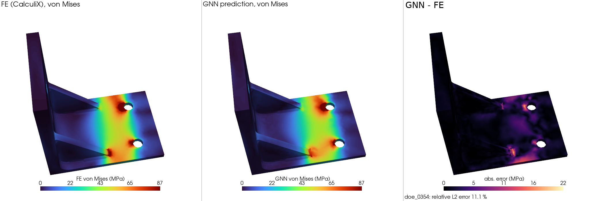
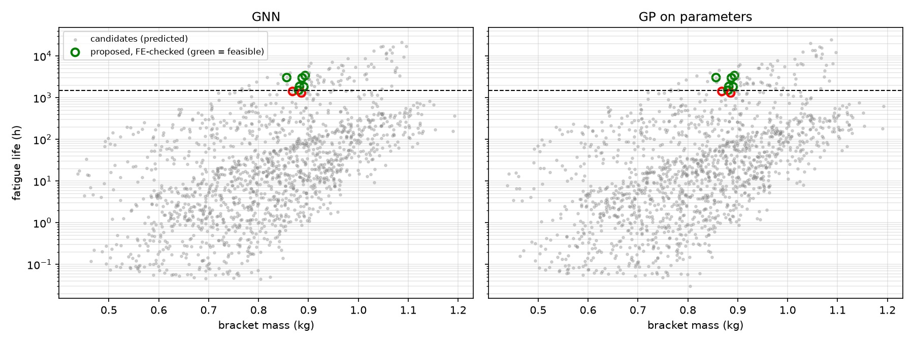

# Graph neural network surrogate for structural FEA

A MeshGraphNet-style graph neural network (GNN) that predicts the static displacement and stress
fields, the first natural frequency, the peak stress and the random-vibration fatigue life of a
parametric steel bracket directly from its mesh, trained on CalculiX finite element results.
The trained model is then used to screen 1,500 new designs in minutes, and the designs it proposes are
checked with the full FE analysis.

The FE model, the verification and the design of experiments are in the companion repository
[`bracket-fea`](https://github.com/RonHooo/bracket-fea).

## Data

* 400 designs from a Latin hypercube over 6 geometric variables (plate thicknesses, fillet radius,
  optional gussets, optional lightening hole).
* Two extrapolation sets: 40 "out-of-distribution" (OOD) designs with one or two variables outside
  the training ranges, and 30 designs from a **shifted family** in which the width, height,
  mounting-hole height and bolt position change. Those four dimensions are fixed in the training data
  and are not among the 6 design variables.
* Each design: CalculiX static analysis (C3D10, 25k-183k nodes), 10 modes, random-vibration fatigue.
* Split: train 280, validation 60, test 60 (random).
* Graph: the same geometry re-meshed with coarse linear tetrahedra (3-5k nodes), FE displacement and
  stress components interpolated onto its nodes. Edges are the tetrahedron edges.

## Model

* Inputs per node: position, three 0/1 flags (fixed bolt-hole surface, mounting-hole surface, free
  surface) and the 6 design variables. Edge features: relative position and length.
* Encode-process-decode with residual message passing (Pfaff et al., 2021), 10 layers, 64 features.
* A global latent ("virtual node") that reads the mean of all node latents and is fed back to every
  node and edge in every layer, as a path for long-range information.
* Node outputs: displacement (3) and the 6 stress components; von Mises is computed from the predicted
  components. Graph-level outputs: log f1, log10 fatigue life, log peak von Mises of the full FE mesh.
* Loss: MSE of standardised targets, node and graph terms weighted equally. AdamW, cosine schedule,
  50 epochs (about 1 h on an M3 laptop GPU).

## Results

### Accuracy on 60 unseen test designs

| model | u field | von Mises field | f1 | peak von Mises | log10 life | von Mises field, shifted family |
|---|---|---|---|---|---|---|
| GNN, stress-component targets (final) | 9.0 % | 11.3 % | 0.82 % | 3.0 % | 0.085 | 20.0 % |
| GNN, von Mises target | 5.0 % | 21.7 % | 0.86 % | 2.8 % | 0.089 | 39.4 % |
| GNN, von Mises target, no global node | 5.0 % | 20.8 % | 1.15 % | 3.0 % | 0.102 | 36.3 % |
| GNN, von Mises target, mesh only (no design variables) | 15.2 % | 29.0 % | 4.01 % | 8.7 % | 0.245 | 43.0 % |
| GNN, von Mises target, mesh only, no global node | 98.4 % | 33.3 % | 5.43 % | 9.8 % | 0.313 | 44.1 % |
| point-wise MLP, no edges (von Mises target) | 5.9 % | 33.8 % | - | - | - | 43.4 % |
| GP on the 6 design variables | - | - | 0.10 % | 2.5 % | 0.101 | - |

(Relative L2 errors are averaged over designs; f1, peak stress and life are mean absolute errors.
A log10 error of 0.085 means the predicted life is off by a factor of 10^0.085 = 1.22 on average.)

* **Predicting the stress components instead of von Mises halved the von Mises field error**
  (21.7 % -> 11.3 %) and cut the error of the field maximum from 15 % to 6 %. Von Mises has a kink
  where the stress changes sign (for example at the neutral plane of a plate in bending), while the
  components are smooth. The displacement error went up from 5.0 % to 9.0 %, because the same network
  now has 9 node outputs instead of 4.
* **Mesh connectivity matters for stress, much less for displacement.** The point-wise MLP sees the
  same node positions and design variables but no neighbours: its displacement error is close to the
  GNN's (5.9 % vs 5.0 %), its von Mises error is much larger (33.8 % vs 21.7 %).
* **The design variables carry most of the information.** With the mesh only, the displacement error
  triples (15.2 % vs 5.0 %), the f1 and life errors are 4.7x and 2.8x larger, and the von Mises error
  rises from 21.7 % to 29.0 %.
* **The global node matters only when the design variables are missing.** With the design variables
  given to every node, removing it changed little. With the mesh only, removing it made the
  displacement prediction fail (98 % error vs 15 %): ten message-passing steps reach only a small part
  of the bracket, so a node cannot tell how stiff the whole structure is, and the displacement
  magnitude depends on exactly that.
* **For the scalar outputs of this family a GP on the 6 variables is as good or better** (f1 0.10 %
  vs 0.82 %). With 340 training designs and a smooth response, a GP is hard to beat. The GNN adds the
  full fields.





### Extrapolation

| | GNN (final) | GP |
|---|---|---|
| OOD designs (40): f1 / peak stress / log10 life | 3.6 % / 5.9 % / 0.127 | 0.56 % / 5.1 % / 0.170 |
| Shifted family (30): f1 / peak stress / log10 life | 5.8 % / 7.7 % / 0.097 | 5.8 % / 7.5 % / 0.114 |
| Shifted family: displacement / von Mises field | 18.8 % / 20.0 % | - |

Both surrogates degrade by a similar amount outside the training family. I expected the mesh input
to give the GNN a clear advantage on the shifted family; it did not. In the parity plots the GNN also
saturates at the edge of the training range (high f1, high stress), where the GP extrapolates better.

### Design screening

1,500 new candidate designs were meshed (5 min on 4 cores) and evaluated by the GNN with von Mises
targets (1.5 min, including GPU kernel compilation). Each surrogate proposed its 8 lightest designs
predicted to meet f1 >= 100 Hz and a fatigue life of at least 1,500 h (the 1,000 h target with the
1.5 mesh margin from `bracket-fea`), and those were checked with the full CalculiX analysis.

* GNN and GP proposed the same 8 designs; 6 of 8 met the requirements in FE (the 2 misses had
  1,300-1,400 h instead of the 1,500 h screening limit).
* The best verified design weighs **0.856 kg**, 3 % lighter than the best of the 400 DOE designs
  (0.884 kg) and 8 % lighter than a uniformly thickened bracket (0.932 kg). It meets f1 >= 100 Hz by
  only 0.15 Hz on a fine mesh, so with any frequency margin the DOE design is the safer choice.
* Running all 1,500 candidates through FE would have taken about 32 CPU-hours; the screening used
  about 15 CPU-minutes plus 8 FE checks.



## Limitations and next steps

* One design family, 280 training designs. The GNN did not generalise to the shifted family better
  than the parameter-based GP; a multi-scale (hierarchical) GNN and more varied geometry would be the
  next step.
* The graph is a coarse re-mesh, so stress peaks in small fillets are under-resolved; the peak stress
  comes from the graph-level head.
* Each variant was trained once (one random seed), so small differences between variants, such as
  with and without the global node, may not be significant.

## Notes on the implementation

* Pure PyTorch (no PyG); scatter operations with `index_add_` / `scatter_reduce`.
* Apple-silicon GPU (MPS): the backend recompiles kernels for every new tensor shape, which made
  training with variable-size graphs very slow. Batches are padded to node / edge counts that are
  multiples of 1024 / 8192; padding nodes form a dummy graph that is masked out of the loss.
* PyTorch 2.15 MPS crashes on macOS 14 (`arrayViewWithShape:strides:`); 2.14.1 works.

## Reproduce

Clone this repository and `bracket-fea` into the same folder; the commands below assume
`../bracket-fea`. The FE dataset (about 1.2 GB) is not in the repository. It is regenerated with `bracket-fea`
(`studies/doe.py --n 400 --n-shift 30`, about 11 CPU-hours), which writes `data/raw/*.npz`.

```bash
PYTHONPATH=.:../bracket-fea python scripts/build_graphs.py
python -m gnnsurrogate.train --targets stress --out results/runs/gnn_stress
python -m gnnsurrogate.evaluate --run results/runs/gnn_stress
python -m gnnsurrogate.baselines
python scripts/screen_designs.py
python scripts/make_figures.py
python scripts/results_table.py
```

## License

MIT. See [LICENSE](LICENSE).
