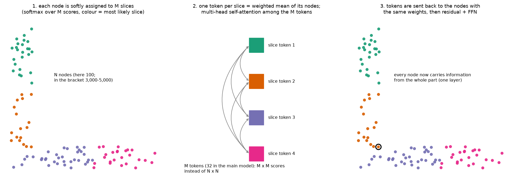
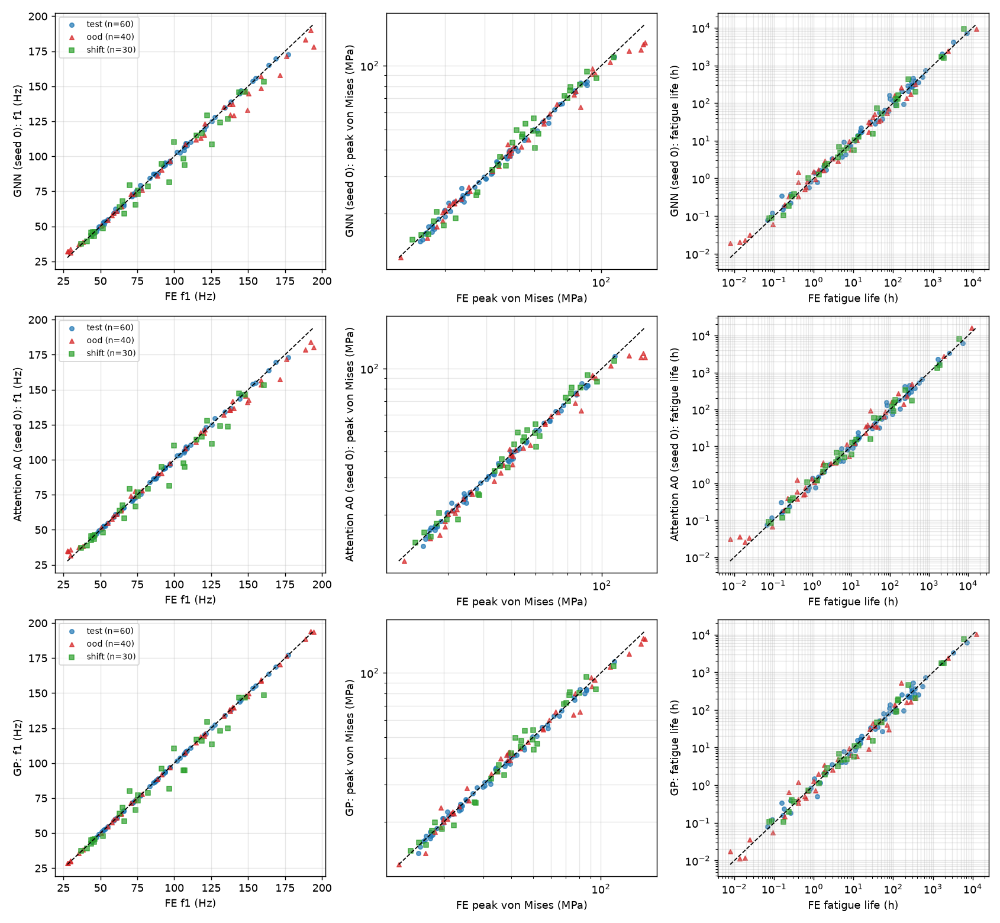
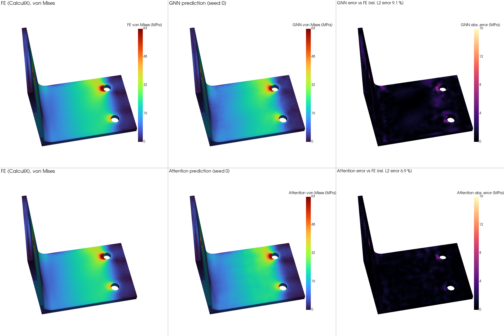
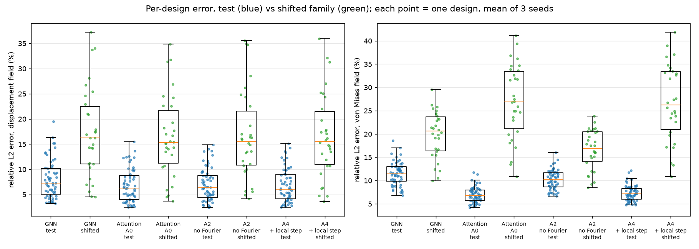
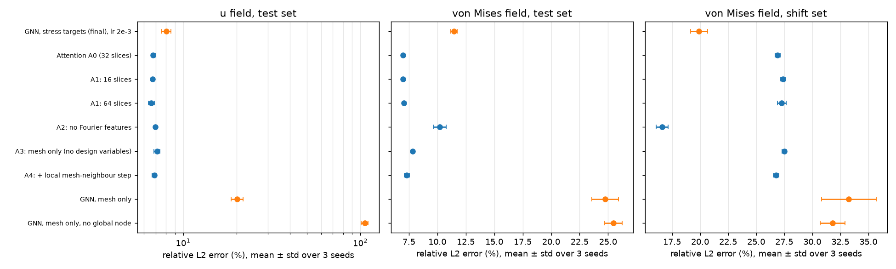
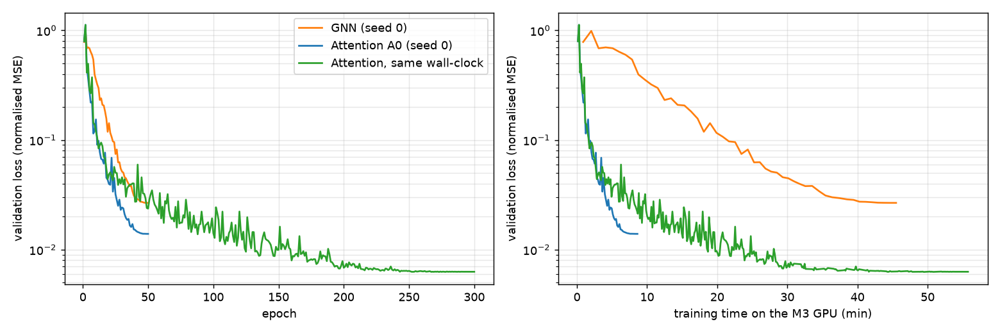
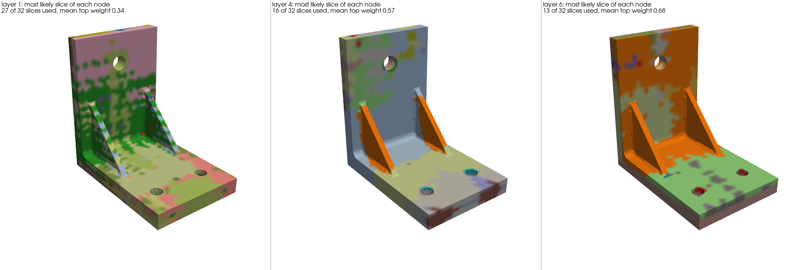

# Attention-based surrogate: full results

Details for the "Attention-based surrogate" section of the [README](../README.md). The questions and
predictions were written before the first training run ([attention_plan.md](attention_plan.md)). All
numbers come from `results/attention/tables.md`, which `scripts/compare_attention.py` builds from the
`summary.json` of each run.

## Model

* Node inputs as for the GNN, plus Fourier features of the position (sin and cos of 2^k·π·x,
  k = 0..5, x in units of 100 mm; 36 extra features). No edges.
* 6 pre-norm blocks with 96 features; each block is slice attention plus a feed-forward network.
* **Slice attention** (after Transolver, Wu et al. 2024): a softmax assigns every node softly to 32
  slices, each slice token is the weighted mean of its nodes, the 32 tokens exchange information with
  4-head self-attention, and the result goes back to the nodes with the same weights. The cost is
  O(N·M) instead of O(N²) (N ≈ 3,800 nodes, M = 32 slices), and every node gets information from the
  whole bracket in one layer. The 4 heads share one set of slice weights (Transolver uses one per head).
* Graph-level outputs: attention pooling (4 heads) followed by an MLP.
* Softmax, scaled dot-product attention and multi-head attention are written by hand in
  [`gnnsurrogate/attention.py`](../gnnsurrogate/attention.py), without `nn.MultiheadAttention`. The
  tests in [`tests/test_attention.py`](../tests/test_attention.py) compare them with
  `torch.nn.functional.scaled_dot_product_attention` (max. difference below 1e-5 in float32) and with
  `nn.MultiheadAttention` using copied weights. They also check that shuffling the node order shuffles
  the output in the same way, and that designs in one batch do not mix.

## Fair comparison

| | GNN | attention (A0) |
|---|---|---|
| parameters | 530,956 | 641,302 |
| epochs, batch, optimiser | 50, 4 designs, AdamW + cosine | same |
| learning rate (5e-4 / 1e-3 / 2e-3, lowest validation loss) | 2e-3 | 2e-3 |
| seeds | 0, 1, 2 | 0, 1, 2 |
| training time, 50 epochs, M3 laptop GPU | 40-46 min | 7-12 min |

* The GNN in the first part of the README used lr 1e-3 without tuning and one seed. Tuning only the
  attention model would have been a second difference, so the GNN got the same grid and the same
  rule. For the GNN, 2e-3 and 1e-3 were a tie (validation loss 0.0267 vs 0.0268), and its test errors
  barely changed (first two rows below).
* Same number of epochs, not the same time. A side run with 300 epochs gives the attention model
  about the GNN's training time (one seed).
* The test, OOD and shifted sets were evaluated once, after all runs had finished. All choices used
  the validation set.
* I call a difference real only if the difference of the seed means is larger than the larger of the
  two seed standard deviations. With 3 seeds this is a minimum bar, not a significance test.

## Results on the 60 test designs (mean ± std over 3 seeds)

| model | seeds | u field | von Mises field | f1 | peak von Mises | log10 life | von Mises field, shifted family |
|---|---|---|---|---|---|---|---|
| GNN, stress targets, lr 2e-3 | 3 | 8.0 ± 0.5 % | 11.5 ± 0.3 % | 0.94 ± 0.11 % | 2.8 ± 0.0 % | 0.085 ± 0.003 | 19.9 ± 0.8 % |
| GNN in the README's first table (lr 1e-3) | 1 | 9.0 % | 11.3 % | 0.82 % | 3.0 % | 0.085 | 20.0 % |
| **Attention A0** | 3 | **6.8 ± 0.2 %** | **7.0 ± 0.0 %** | 0.70 ± 0.03 % | 2.6 ± 0.1 % | 0.082 ± 0.002 | 26.9 ± 0.2 % |
| A0, 300 epochs (about the GNN's training time) | 1 | 2.6 % | 3.2 % | 0.68 % | 2.5 % | 0.081 | 26.4 % |
| GP on the 6 design variables | - | - | - | **0.10 %** | 2.5 % | 0.101 | - |
| point-wise MLP, no edges (von Mises target) | 1 | 5.9 % | 33.8 % | - | - | - | 43.4 % |

* **The attention model had lower field errors than the GNN**: displacement 6.8 % vs 8.0 %, von Mises
  7.0 % vs 11.5 %. f1 was also lower (0.70 % vs 0.94 %), peak stress slightly lower (2.6 % vs 2.8 %),
  and fatigue life a tie (0.082 vs 0.085, within the seed spread).
* **Part of the von Mises gain comes from the Fourier features, not from attention.** Without them
  (A2, below) the von Mises error is 10.2 %: still lower than the GNN's 11.5 %, but far from 7.0 %. The
  GNN has no Fourier features, so this comparison has two differences. A GNN with Fourier features
  is the missing control.
* **The GP is still the best model for f1** (0.10 % vs 0.70 %, and 0.56 % vs 3.6 % on the OOD
  designs). I think the reason is that f1 is a smooth function of 6 numbers, and a GP fitted to 340
  designs interpolates such a function very well, while the networks learn f1 together with 9 field
  outputs on about 4,000 nodes per design. Longer training did not lower the f1 error (next point).
  On peak stress the GP and the attention model are about the same (2.5 % vs 2.6 %), and on life both
  networks are better than the GP (0.082 and 0.085 vs 0.101).
* With 300 epochs (56 min, a little more than the GNN's 40-46 min; its validation loss had reached
  its final value by 46 min), the field errors fell to 2.6 % and 3.2 %, but f1, peak stress and life
  did not change. So the scalar outputs are limited by something other than training time. This is
  one seed.

The test design with the median attention error (seed 0): GNN 9.1 %, attention 6.9 %. Both models
have their largest errors next to the two bolt holes in the base plate; the GNN error is larger there
and spread more widely.

## Mesh only (question 2)

| test set | u field | von Mises field | f1 | log10 life |
|---|---|---|---|---|
| Attention A0 (with the design variables) | 6.8 ± 0.2 % | 7.0 ± 0.0 % | 0.70 ± 0.03 % | 0.082 ± 0.002 |
| Attention A3, mesh only | 7.1 ± 0.3 % | 7.8 ± 0.1 % | 0.78 ± 0.04 % | 0.078 ± 0.003 |
| GNN, mesh only | 20.2 ± 1.5 % | 24.7 ± 1.2 % | 3.59 ± 0.31 % | 0.224 ± 0.042 |
| GNN, mesh only, no global node | 106.0 ± 4.9 % | 25.5 ± 0.8 % | 3.91 ± 0.01 % | 0.261 ± 0.022 |

* The GNN mesh-only runs in the README's first table used von Mises targets. They were retrained here with
  stress-component targets and 3 seeds, so that the model is the only difference.
* **Without the design variables, the attention model lost little** (displacement 7.1 % vs 6.8 %,
  von Mises 7.8 % vs 7.0 %). On the test set it is still better than the GNN that is given the design
  variables. The GNN without a global node failed again (106 % displacement error).
* I think the reason is that every node sees the whole bracket in the first layer, so the model can
  read the plate thicknesses, fillet and gussets from the geometry. I did not test this directly.
* The design variables still help outside the training ranges: on the OOD designs the mesh-only
  model has 17.6 % displacement error vs 13.8 % with them, and 4.7 % vs 3.6 % on f1.

## Extrapolation (question 3)

| | GNN | Attention A0 | Attention A2 (no Fourier) | GP |
|---|---|---|---|---|
| OOD designs (40): f1 / peak stress / log10 life | 3.45 ± 0.33 % / 5.7 ± 0.5 % / 0.141 ± 0.007 | 3.57 ± 0.41 % / 6.9 ± 0.5 % / 0.142 ± 0.008 | 3.13 ± 0.36 % / 5.4 ± 0.5 % / 0.128 ± 0.005 | 0.56 % / 5.1 % / 0.170 |
| Shifted family (30): f1 / peak stress / log10 life | 5.57 ± 0.13 % / 7.9 ± 0.2 % / 0.100 ± 0.002 | 5.53 ± 0.15 % / 7.1 ± 0.1 % / 0.100 ± 0.010 | 5.00 ± 0.22 % / 6.9 ± 0.1 % / 0.097 ± 0.002 | 5.75 % / 7.5 % / 0.114 |
| OOD designs: displacement / von Mises field | 14.9 ± 1.0 % / 16.4 ± 0.5 % | 13.8 ± 0.2 % / 14.1 ± 0.2 % | 14.2 ± 0.2 % / 14.9 ± 0.7 % | - |
| Shifted family: displacement / von Mises field | 17.2 ± 0.3 % / 19.9 ± 0.8 % | 16.4 ± 0.2 % / **26.9 ± 0.2 %** | 16.6 ± 0.3 % / **16.6 ± 0.5 %** | - |

* **On the shifted family the attention model was worse than the GNN** on the von Mises field
  (26.9 % vs 19.9 %). Displacement was about the same for all models (16-17 %).
* **Without the Fourier features (A2) the shifted von Mises error drops to 16.6 %**, lower than the
  GNN's. The Fourier features encode the absolute position down to about 6 mm, and in the shifted
  family the holes and edges sit at positions never seen in training. A2 pays for this on the test
  set (10.2 % vs 7.0 %). So the position encoding sets a trade-off between accuracy inside the
  training family and extrapolation.
* On the OOD designs the attention model had lower field errors than the GNN, but a higher peak
  stress error (6.9 % vs 5.7 %).

## Ablations (test set)

| model | u field | von Mises field | f1 | peak von Mises | log10 life | von Mises field, shifted family |
|---|---|---|---|---|---|---|
| Attention A0 (32 slices) | 6.8 ± 0.2 % | 7.0 ± 0.0 % | 0.70 ± 0.03 % | 2.6 ± 0.1 % | 0.082 ± 0.002 | 26.9 ± 0.2 % |
| A1: 16 slices | 6.7 ± 0.1 % | 7.0 ± 0.1 % | 0.72 ± 0.06 % | 2.6 ± 0.2 % | 0.081 ± 0.003 | 27.4 ± 0.2 % |
| A1: 64 slices | 6.6 ± 0.3 % | 7.1 ± 0.0 % | 0.76 ± 0.10 % | 2.5 ± 0.1 % | 0.081 ± 0.003 | 27.3 ± 0.4 % |
| A2: no Fourier features | 7.0 ± 0.1 % | 10.2 ± 0.6 % | 0.83 ± 0.08 % | 2.9 ± 0.1 % | 0.083 ± 0.005 | 16.6 ± 0.5 % |
| A3: mesh only | 7.1 ± 0.3 % | 7.8 ± 0.1 % | 0.78 ± 0.04 % | 2.4 ± 0.1 % | 0.078 ± 0.003 | 27.5 ± 0.2 % |
| A4: + local mesh-neighbour step | 6.9 ± 0.2 % | 7.3 ± 0.2 % | 0.67 ± 0.06 % | 2.4 ± 0.3 % | 0.083 ± 0.003 | 26.8 ± 0.2 % |

* The number of slices (16, 32, 64) made no difference that matters (at most 0.1 points of test von
  Mises error).
* Adding a mesh-neighbour averaging step to every block (A4) did not help (7.3 % vs 7.0 %), and it
  made inference 3x slower.

## Inference time and training curves

| model | parameters | time per design |
|---|---|---|
| GNN | 530,956 | 52 ms |
| Attention A0 (32 slices) | 641,302 | 5.6 ms |
| A1: 16 / 64 slices | 631,990 / 659,926 | 4.8 / 7.2 ms |
| A4: + local step | 809,494 | 16.4 ms |
| point-wise MLP | 267,524 | 1.4 ms |

One design per forward pass, padded as in training, on the M3 laptop GPU (MPS); median of 5 passes
over the 60 test designs, all models timed one after another in the same process
(`scripts/time_inference.py`). Most of the GNN's work is on the edges (about 39,000 per design,
10 layers); the attention model works on the nodes (about 3,800) and a 32 x 32 attention matrix.

## What the slices learned

The most likely slice of each node, seed 0, layers 1, 4 and 6. In the first layer the slices are
scattered patches and 27 of the 32 slices are used. In the last layer only 13 are used, and the large
ones follow the parts of the bracket: the gussets with the fillet, the base plate, the upright.

## Predictions vs results

| prediction (before training) | result |
|---|---|
| Test: displacement about the same as the GNN or lower | Lower: 6.8 % vs 8.0 %. |
| Test: von Mises higher than the GNN's 11.3 %, because slice tokens average out local peaks | **Wrong**: 7.0 %. My guess: each node keeps its own features through the residual path, and the Fourier features describe its position in fine detail (without them: 10.2 %). |
| Test: scalars about the same; the GP stays best on f1 | f1 lower than the GNN (0.70 % vs 0.94 %), peak stress and life about the same; the GP is best on f1. |
| Mesh only: displacement far below 98 %, close to the GNN with a global node | Far below (7.1 %), and also much better than the GNN with a global node (20.2 %). |
| Shifted family: no improvement, possibly worse; if the Fourier features are the reason, A2 does better | Worse (26.9 % vs 19.9 %); A2 does better (16.6 %). |

## Choices I made

| choice | reason |
|---|---|
| One set of slice weights shared by all heads | Simpler; I did not test one set per head. |
| Model size (96 features, 6 blocks, 32 slices) fixed before training; only the learning rate was tuned | Keeps the validation set from being used for many choices. |
| lr 2e-3 is at the edge of the grid; the grid was not extended | The rule was fixed in advance. A larger value might be better for both models. |
| Same epochs as the GNN, plus one 300-epoch run | The GNN takes about 5x longer per epoch. |
| A4 averages over the mesh neighbours, not over k nearest neighbours | The mesh edges are already there and are what the GNN uses. |
| Model weights in git for the main runs only (attention, GNN and 300-epoch runs) | About 2.5 MB each; the ablation and learning-rate runs keep their configs, histories and metrics. |
| The optional re-screening of the 1,500 designs with the attention model was not done | Out of time; the GNN and GP already agreed on the designs. |

## Numbers that change on a rerun

* Training on the Apple GPU is not bit-for-bit repeatable. The seed spread in the tables shows the
  size of the variation (for example 0.3 points on the GNN's von Mises error).
* Times depend on the machine and on what else runs. The same attention model took 7.4-12.1 min for 50
  epochs; the slow runs overlapped with CPU-heavy jobs on the same laptop.
* The 300-epoch run and the slice figure are one seed each.

## Limitations

* One bracket family and 280 training designs. This does not show that attention is better than
  message passing in general.
* The attention model has Fourier features and the GNN does not; a GNN with Fourier features would
  separate the two effects.
* Three seeds per model.
